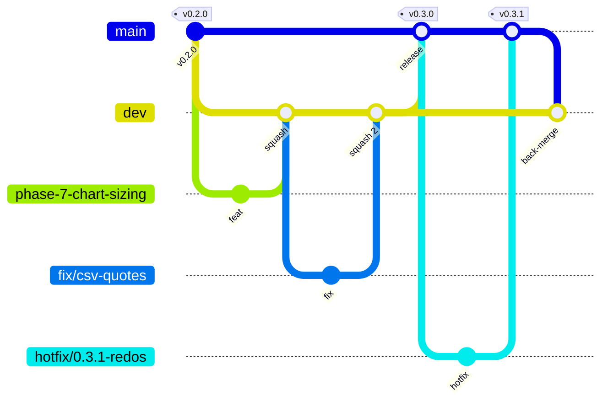

# Contributing to MDV

Thanks for helping. This guide covers how code moves from your branch to a release, and the security checks it must pass along the way.

Before proposing a feature, read the **Core Product Decisions** in [`CLAUDE.md`](CLAUDE.md). MDV deliberately has no code in the authoring surface, no data transformations, and no remote data. A PR that crosses those lines will be declined, however well it's built.

## Branching model

MDV uses two long-lived branches:

| Branch | Purpose | Receives changes from | Merge method |
|---|---|---|---|
| `dev` (default) | Integration. Always builds and passes tests; it's the next release in progress. | Feature, fix, docs, and chore branches; Dependabot; back-merges from `main` | **Squash** (one commit per PR). Back-merges from `main` use a merge commit. |
| `main` | Released code. Every commit on `main` is a release or a hotfix. Pages deploys from here. | Release PRs (`dev` → `main`) and hotfix branches | **Merge commit** (keeps `dev` and `main` histories shared) |



### Branch names

Short-lived branches are created from `dev`, except hotfixes. Use kebab-case:

| Prefix | Use for | Example |
|---|---|---|
| `phase-<N>-` | A roadmap phase (maintainers) | `phase-7-chart-sizing` |
| `feat/` | A new capability | `feat/table-align` |
| `fix/` | A bug fix | `fix/tsv-ragged-rows` |
| `docs/` | Documentation only | `docs/charts-yformat` |
| `chore/`, `ci/`, `deps/` | Tooling, CI, dependencies | `ci/node-24-matrix` |
| `hotfix/` | An urgent fix to a released version (**branch from `main`**) | `hotfix/0.3.1-redos` |
| `release/` (optional) | Release prep, if a release needs extra commits | `release/0.3.0` |

### Commit messages

Use [Conventional Commits](https://www.conventionalcommits.org/): `feat(core): …`, `fix(cli): …`, `docs: …`, `chore(deps): …`, `ci: …`. The squash-merge commit takes the PR title, so **write the PR title in this format.**

## Everyday flow: change → `dev`

```bash
git checkout dev && git pull --ff-only
git checkout -b fix/short-description
# … make the change, with tests …
npm ci && npm run build && npm test
git push -u origin fix/short-description
gh pr create --base dev --fill
```

To be mergeable into `dev`, a PR needs:

1. **All required checks green**: `Build & test (Node 20)`, `Build & test (Node 22)`, `Analyze (javascript-typescript)`, `Analyze (actions)`, and `Dependency review`.
2. **No new high-severity code-scanning alerts** (the CodeQL merge gate).
3. **All review conversations resolved.**
4. The PR template filled in, including the security section.

`dev` doesn't require an approving review, so passing checks are enough for a maintainer to merge. Maintainers then **squash-merge** and the branch is deleted automatically.

## Releasing: `dev` → `main`

A maintainer cuts a release when `dev` holds something worth shipping:

1. On a branch from `dev` (or a `release/X.Y.Z` branch):
   - rename `## [Unreleased]` in `CHANGELOG.md` to `## [X.Y.Z] — YYYY-MM-DD`
   - bump `version` in `packages/*/package.json` and `VERSION` in `packages/mdv-core/src/index.ts`
   - open a PR into `dev`, and merge it.
2. Open the release PR:
   ```bash
   gh pr create --base main --head dev --title "release: vX.Y.Z" --body "See CHANGELOG.md [X.Y.Z]"
   ```
3. Requirements:
   - every required check passes again against `main`
   - no open **critical or high** CodeQL or Dependabot alerts on `dev`
   - **1 approving review** (the owner may use the admin bypass, through the PR only).
4. **Merge with a merge commit.** Don't squash: squashing would make `dev` and `main` diverge.
5. Tag the merge commit on `main` and push the tag:
   ```bash
   git checkout main && git pull --ff-only
   git tag vX.Y.Z && git push origin vX.Y.Z
   ```
   For the VS Code extension, push a `vscode-vX.Y.Z` tag. That triggers the release workflow.

## Hotfixes: urgent fix → `main` → `dev`

For a security or severe bug in a released version that can't wait for the next release:

1. `git checkout main && git pull --ff-only && git checkout -b hotfix/X.Y.Z-short-name`
2. Fix it, add a test, add a `CHANGELOG.md` entry under a new `## [X.Y.Z]` patch heading, and bump versions.
3. Open a PR into **`main`**. It needs the same checks and the 1 review. Merge it with a merge commit and tag it.
4. **Back-merge immediately**:
   ```bash
   gh pr create --base dev --head main --title "chore: back-merge vX.Y.Z into dev"
   ```
   Merge it with a **merge commit** so `dev` contains the hotfix.

For **undisclosed** security vulnerabilities, do the fix in a [temporary private fork](https://docs.github.com/en/code-security/security-advisories/working-with-repository-security-advisories/collaborating-in-a-temporary-private-fork-to-resolve-a-repository-security-vulnerability) created from the private security advisory, not in a public branch. See [SECURITY.md](SECURITY.md).

## Security checks on pull requests

Every PR into `dev` or `main` runs these. **Don't merge around a failing security check.** Fix it, or have a maintainer record a justified dismissal.

### CodeQL (code scanning)

- **What it does:** static analysis using the `security-extended` query suite, covering JavaScript/TypeScript (`packages/`, `scripts/`) and the GitHub Actions workflows.
- **On your PR:** new alerts appear as annotations on the changed lines and in the *Checks* tab. A new alert of **high or critical** security severity (or any **error**-level alert) blocks merging.
- **What to do:**
  1. Open the alert and read the explanation and the data flow it shows.
  2. **Fix the code.** Typical MDV fixes: escape output with `escapeHtml` (`packages/mdv-core/src/render/svg-util.ts`); anchor regexes and avoid nested or overlapping quantifiers (ReDoS); resolve paths with the dataset-loader guard.
  3. Push the fix. The alert closes automatically.
  4. If it's genuinely a false positive or not exploitable, **a maintainer** dismisses it in the Security tab, choosing *False positive* or *Won't fix* and writing a one-sentence justification. Never dismiss without a reason.

### Dependency review

- **What it does:** compares `package-lock.json` (and workflow `uses:` lines) between your branch and the base.
- **Fails when:** your PR adds or upgrades to a dependency with a known vulnerability of **moderate** severity or above, or with a GPL or AGPL license (MDV is MIT).
- **What to do:** the failure comment lists each package and the first patched version.
  - Bump to a patched version, or choose a different package.
  - Run `npm ci && npm test` and push.
  - **Never** add a new runtime dependency without discussing it in an issue first.

### Secret scanning and push protection

- **What it does:** blocks a `git push` that contains a recognizable credential (API keys, tokens, private keys), and scans the full history for any that slip through.
- **If your push is blocked:**
  - Remove the secret from the commit (amend or rebase), then push again.
  - **Don't use the "bypass" link** unless the value is a documented test fixture.
- **If a real secret reached GitHub:**
  - **Revoke or rotate it first.** Assume it's compromised the moment it was pushed.
  - Then remove it from history and tell the maintainer.

### Dependabot

- **Security updates** open PRs into `dev` automatically when an advisory affects a dependency already in the lockfile.
  - Treat a **critical or high** one as a hotfix candidate.
  - Moderate and low ones ship with the next release.
- **Version updates** arrive weekly. Maintainers may consolidate a pile of them into a single PR.

## Pull request checklist

The [PR template](.github/pull_request_template.md) prompts for all of this:

- [ ] Based on `dev` (or `main` for a `hotfix/` branch)
- [ ] Tests added or updated; `npm run build` and `npm test` pass
- [ ] Rendered every `examples/*.mdv` before and after; any output differences are intended
- [ ] `docs/` and `CHANGELOG.md` `[Unreleased]` updated for user-facing changes
- [ ] Security: no new CodeQL alerts, dependency review green, no secrets committed, and untrusted-input handling considered

## Reporting bugs and security issues

- Bugs and ideas: [open an issue](https://github.com/drasimwagan/mdv/issues/new).
- **Security vulnerabilities:** never in public. Use [private vulnerability reporting](https://github.com/drasimwagan/mdv/security/advisories/new) as described in [SECURITY.md](SECURITY.md).
